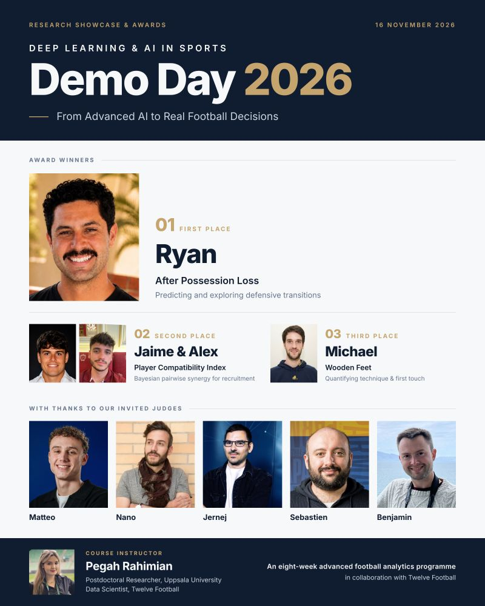
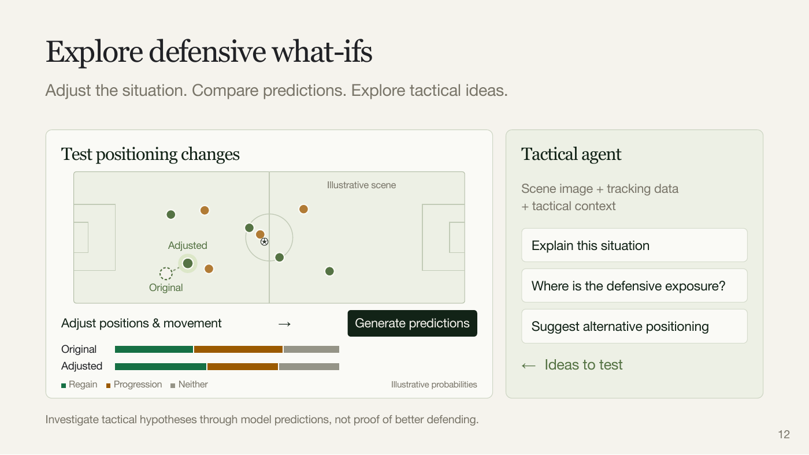

:::: {.transition-award}
::: {.transition-award-copy}
## First among 12 projects

I developed the model during the eight-week course and presented it to five football industry judges at the final Demo Day on November 16, 2026. The panel voted it first out of 12 projects.

The panel included Matteo Matteotti (Inter Milan), Michael Nanopoulos (SkillCorner), Jernej Flisar (Twelve Football), Sebastien Coustou (Gemini Sports AI) and Benjamin Mawdsley (City Football Group).

[View my slides (PDF)](after-possession-loss-slides.pdf){.btn .btn-primary} [Demo Day presentations](https://twelve-courses.teachable.com/courses/2953628/lectures/66591834){.btn .btn-outline-primary}

[Read instructor Pegah Rahimian’s results recap on LinkedIn](https://www.linkedin.com/feed/update/urn:li:activity:7528911404742037504/)
:::

::::

## What happens in the next eight seconds?

A team wins the ball back. Did it defend the transition well, or did its opponent miss a chance to break through? I built a model to estimate how exposed the team was **at the opponent’s first controlled touch**. An analyst can then compare that forecast with what happened on the pitch.

I studied **54,963 open-play possession losses across 648 Premier League matches** using SkillCorner tracking and Dynamic Events data. For losses in the middle and attacking thirds, the model estimated which outcome would happen first within eight seconds: the defending team regained control, the opponent controlled the ball at least 15 metres closer to goal, or neither occurred.

## What movement added to the forecast

I compared XGBoost, using summaries of pressure and team shape, with a graph attention network (GATv2) that represented all 22 players and the ball individually. I tested both with and without movement from the half-second leading up to the opponent’s first touch.

On **8,952 transitions from 99 held-out matches**, the graph model with motion led all six models across the four reported metrics. Its Brier score, which measures error in the predicted probabilities, was **0.5651**, compared with **0.5750** for the same graph without motion and **0.5810** for XGBoost with motion. Lower scores indicate more accurate probabilities. [See the full comparison on slide 10](after-possession-loss-slides.pdf#page=10).

## Exploring a different defensive shape

In the Brighton–West Ham example, I showed how an analyst could move a defender, change the direction of a run and compare the resulting forecasts. The tactical AI assistant suggests adjustments to investigate. The change in predicted risk gives the analyst a hypothesis to test in video review.

{fig-alt="An illustrative pitch shows a defender’s original and adjusted positions alongside the predicted probabilities and tactical assistant."}
