```{=html}
<dl class="transition-capabilities" aria-label="Project capabilities">
  <div><dt>Predict the next eight seconds</dt><dd>A graph neural network tracks how players move to estimate whether the defense will regain the ball or the opponent will advance.</dd></div>
  <div><dt>Analyze the transition</dt><dd>Compare forecasts with match outcomes to spot patterns, then review plays where the defense won the ball back despite being exposed.</dd></div>
  <div><dt>Test defensive what-ifs</dt><dd>Move a defender or change a run in the simulator. Compare the new forecast and explore positioning ideas with a tactical AI assistant.</dd></div>
</dl>
```

## Twelve Football Demo Day – 1st Place [🥇]{aria-hidden="true"} {#twelve-football-demo-day}

I developed the project during the eight-week course and demonstrated the app to five football industry judges on November 16, 2026. The panel voted it first out of 12 projects.

The panel included Matteo Matteotti (Inter Milan), Michael Nanopoulos (SkillCorner), Jernej Flisar (Twelve Football), Sebastien Coustou (Gemini Sports AI) and Benjamin Mawdsley (City Football Group).

```{=html}
<div class="demo-day-links">
<a class="demo-recap" href="https://www.linkedin.com/feed/update/urn:li:activity:7528911404742037504/">
  
  <span><small>Pegah Rahimian · Course instructor</small><strong>Read the Demo Day results on LinkedIn</strong></span>
</a>
<a class="demo-recap" href="https://twelve-courses.teachable.com/courses/2953628/lectures/66591834">
  <span class="demo-play bi bi-play-circle" aria-hidden="true"></span>
  <span><small>Twelve Football · Event recording</small><strong>Watch all Demo Day presentations</strong></span>
</a>
</div>
```

## Demo Day presentation

[View my slides (PDF)](after-possession-loss-slides.pdf){.btn .btn-primary}

```{=html}
<div id="presentation-preview" class="demo-deck carousel slide" role="region" aria-label="Demo Day presentation slides" tabindex="0">
  <div class="carousel-inner">
    <div class="carousel-item active">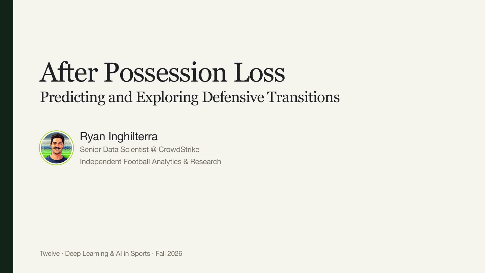</div>
    <div class="carousel-item">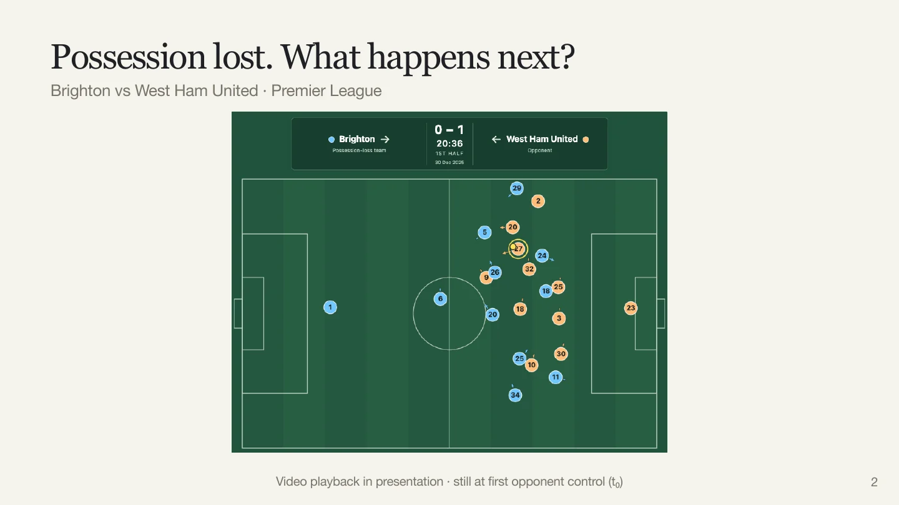</div>
    <div class="carousel-item">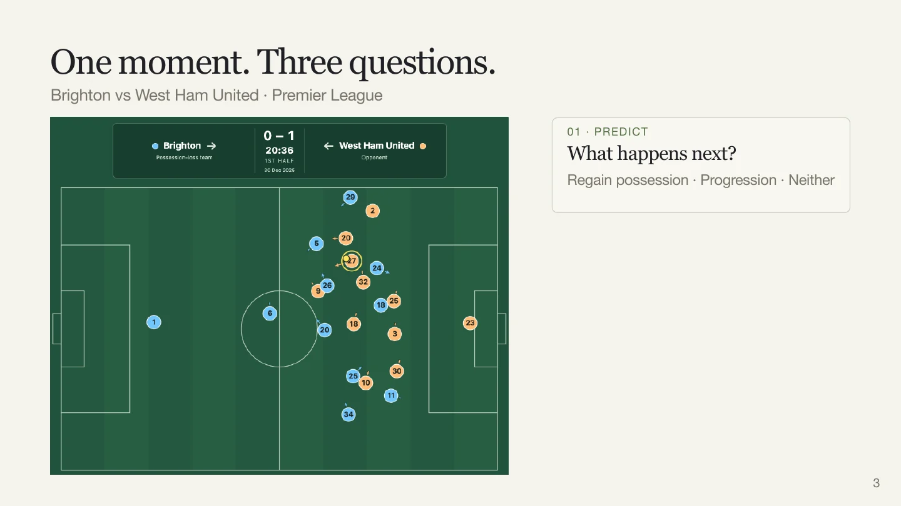</div>
    <div class="carousel-item">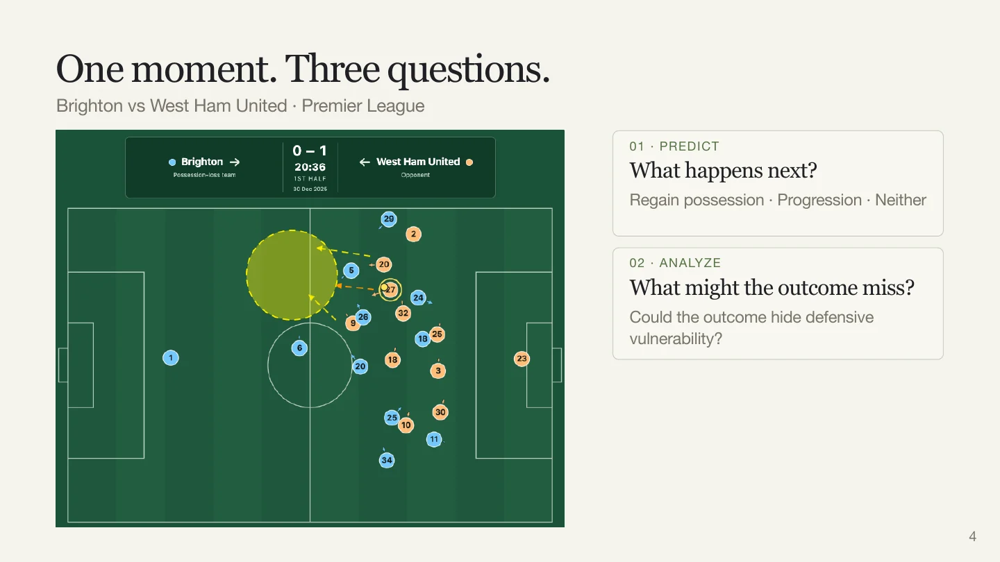</div>
    <div class="carousel-item">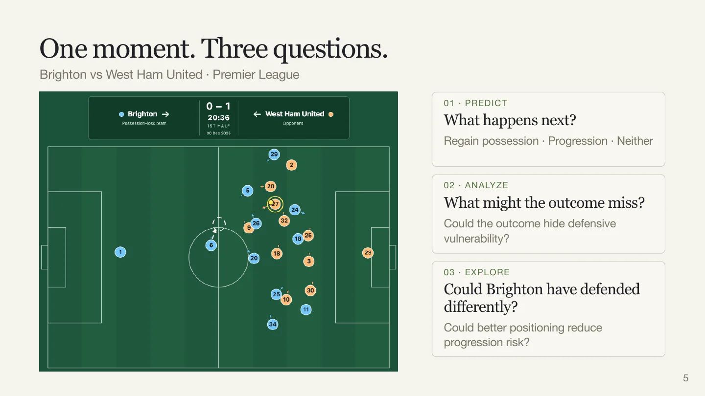</div>
    <div class="carousel-item">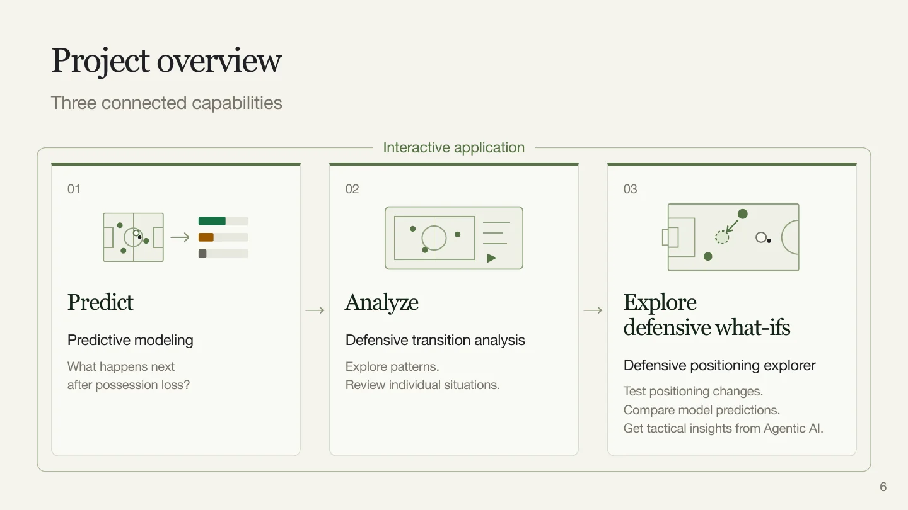</div>
    <div class="carousel-item">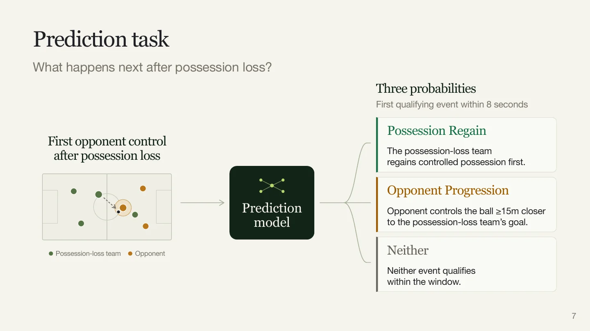</div>
    <div class="carousel-item">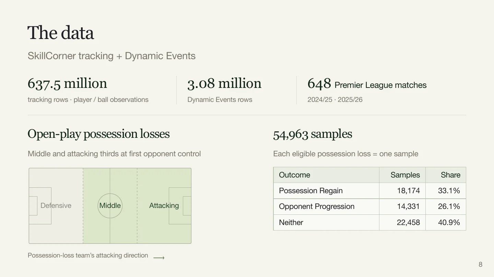</div>
    <div class="carousel-item">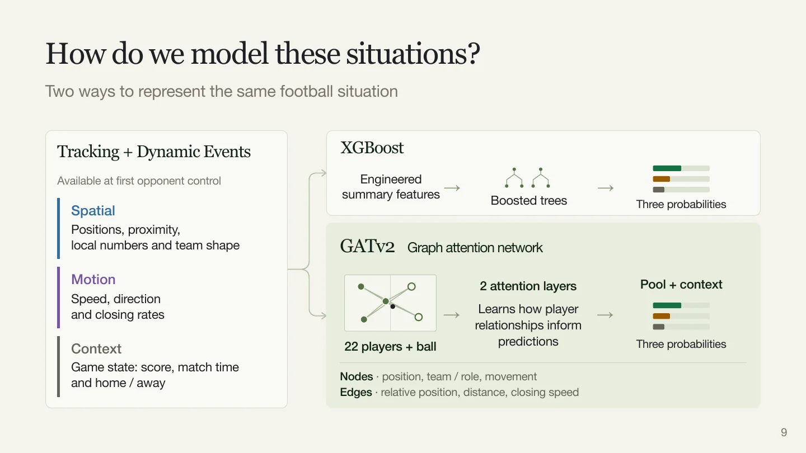</div>
    <div class="carousel-item">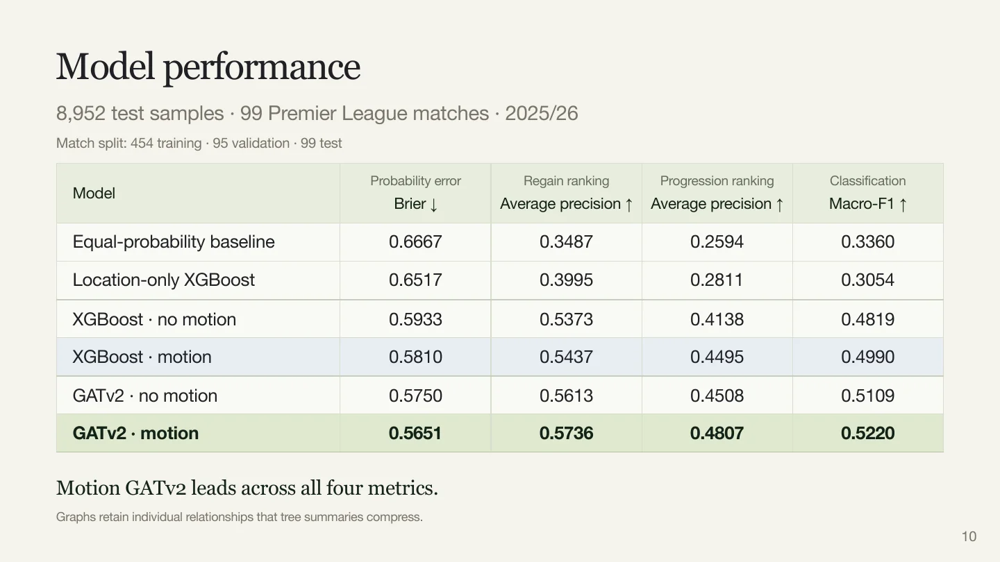</div>
    <div class="carousel-item">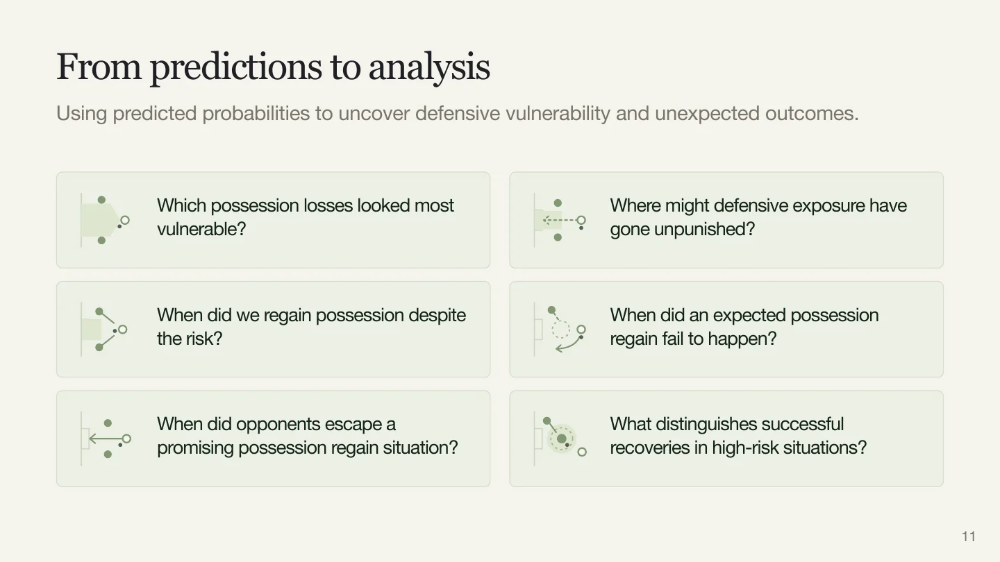</div>
    <div class="carousel-item">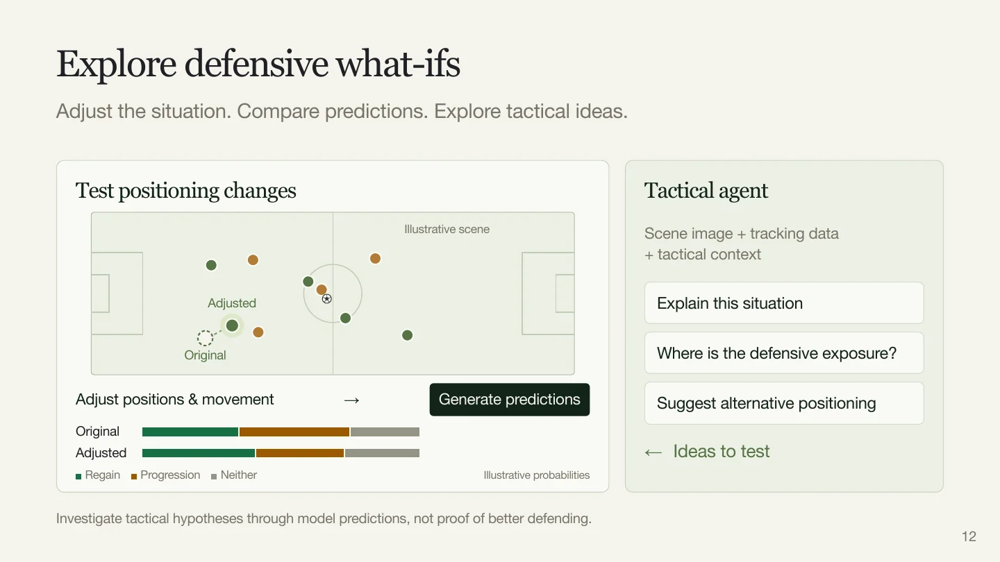</div>
    <div class="carousel-item">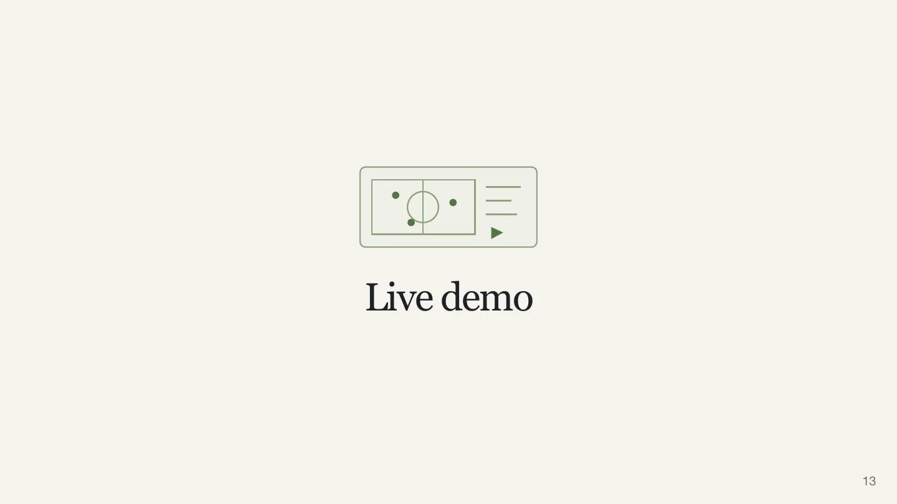</div>
    <div class="carousel-item">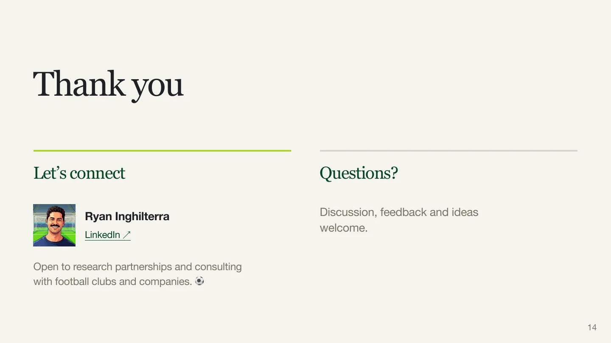</div>
    <div class="carousel-item">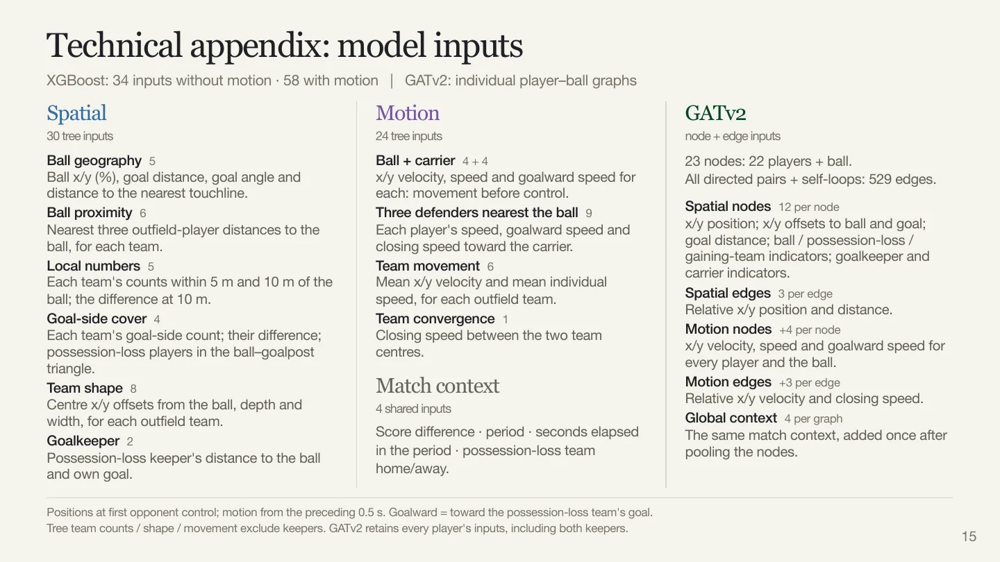</div>
  </div>
  <div class="demo-deck-controls">
    <button type="button" class="btn btn-outline-secondary btn-sm" data-bs-target="#presentation-preview" data-bs-slide="prev" disabled>← Previous</button>
    <span role="status" aria-atomic="true">Slide 1 of 15</span>
    <button type="button" class="btn btn-outline-secondary btn-sm" data-bs-target="#presentation-preview" data-bs-slide="next">Next →</button>
  </div>
</div>
<script>
{
  const deck = document.getElementById('presentation-preview');
  const total = deck.querySelectorAll('.carousel-item').length;
  const previous = deck.querySelector('[data-bs-slide="prev"]');
  const next = deck.querySelector('[data-bs-slide="next"]');
  const count = deck.querySelector('[role="status"]');

  new bootstrap.Carousel(deck, { interval: false, wrap: false });
  deck.addEventListener('slid.bs.carousel', ({ to }) => {
    const focused = document.activeElement;
    previous.disabled = to === 0;
    next.disabled = to === total - 1;
    count.textContent = `Slide ${to + 1} of ${total}`;
    if ((focused === previous && previous.disabled) || (focused === next && next.disabled)) {
      deck.focus({ preventScroll: true });
    }
  });
}
</script>
```
