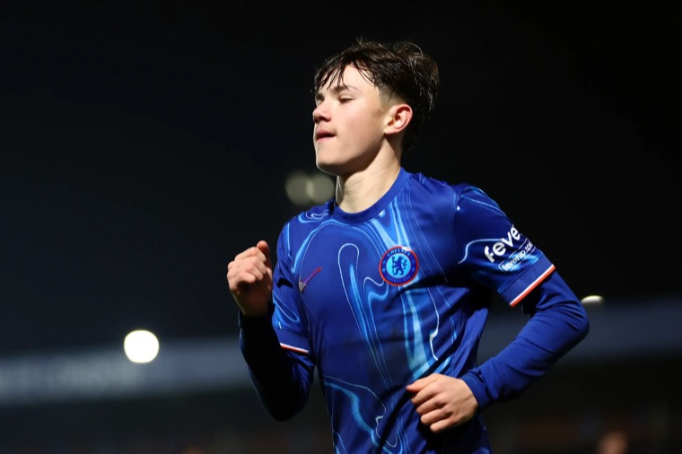
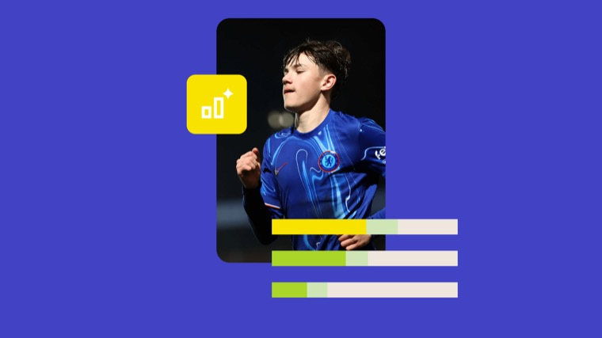
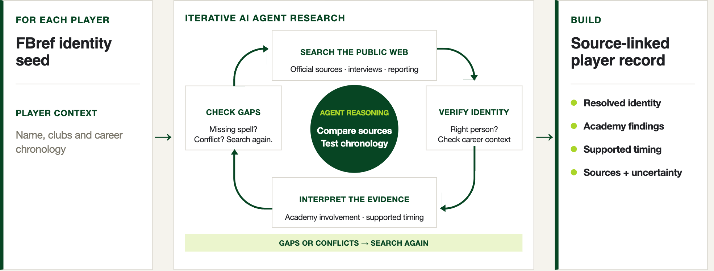

:::::: {.academy-study}

[Football Analytics](../../football-analytics.qmd){.academy-back}

::::: {.academy-opening}
:::: {.academy-intro}
[Training Ground Guru · 2025/26]{.academy-edition}

# Academy Productivity Rankings {.unlisted}

I led Training Ground Guru’s study of how academies in England and Wales develop senior footballers. I built an AI-assisted workflow to trace each player’s academy history and share credit across the clubs that trained him. Plymouth Argyle commissioned the first club report to benchmark its academy against its peers.

[Explore the series](#the-tgg-series){.academy-action} [Inside the masterclass](#inside-the-masterclass)
::::

::: {.academy-pathway}
### From player to ranking {.unlisted .unanchored}

<ol>
<li><strong>Trace the player</strong><span>Start with the player’s senior record and trace academy spells in public sources.</span></li>
<li><strong>Check the evidence</strong><span>The AI agent cross-checks identity and dates, follows gaps and links each finding to a source.</span></li>
<li><strong>Share the credit</strong><span>Use Opta’s league strengths and minutes played to score the senior season. Split the points by time at each academy.</span></li>
</ol>
:::
:::::

::: {.academy-scope}
<div><strong>2,067</strong> players researched</div>
<div><strong>89</strong> academies ranked</div>
<div><strong>23</strong> senior competitions</div>
:::

## The TGG series

I wrote the methodology and the complete table, and co-authored three analyses.

```{=html}
<div class="academy-articles">
<a class="academy-article" href="https://trainingground.guru/chelsea-make-it-four-in-a-row-in-tggs-academy-productivity-rankings/">
  
  <div class="academy-article-copy"><strong>The national rankings and top 20</strong><p>The public top 20 and the clubs that moved up when the study expanded to Wales and 23 senior competitions.</p><small>7 Sep 2026 · With Ian Westbrook</small></div>
</a>
<a class="academy-article" href="https://trainingground.guru/academy-rankings-2025-26-how-the-research-was-done/">
  
  <div class="academy-article-copy"><strong>How the research was done</strong><p>How I reconstructed individual academy spells, weighted senior competitions and allocated credit between clubs.</p><small>7 Sep 2026 · Sole author · TGG members</small></div>
</a>
<a class="academy-article" href="https://trainingground.guru/academy-rankings-2025-26-the-complete-table/">
  
  <div class="academy-article-copy"><strong>The complete 89-academy table</strong><p>All 89 academies, with each club’s score broken down by the competitions its graduates reached.</p><small>7 Sep 2026 · Sole author · TGG members</small></div>
</a>
<a class="academy-article" href="https://trainingground.guru/chelsea-top-u23-academy-rankings-as-everton-leeds-show-their-age/">
  
  <div class="academy-article-copy"><strong>The U23 rankings</strong><p>A younger cohort gives a different view of which academies are producing senior players now.</p><small>17 Sep 2026 · With Ian Westbrook and Simon Austin · TGG members</small></div>
</a>
<a class="academy-article" href="https://trainingground.guru/how-chelsea-built-a-28-point-lead-inside-the-academy-rankings-data/">
  
  <div class="academy-article-copy"><strong>How Chelsea built a 28-point lead</strong><p>Our league-by-league breakdown shows how Premier League graduates drove Chelsea’s advantage over Arsenal.</p><small>23 Sep 2026 · With Ian Westbrook · TGG members</small></div>
</a>
</div>
```

::: {.academy-press-strip}
## Press coverage {#in-the-press}

- **BBC Sport** [Chelsea top national academy rankings again](https://www.bbc.com/sport/football/articles/cvgy8ngm28po)
- **Southampton Daily Echo** [My comments on Southampton’s eighth-place finish](https://www.dailyecho.co.uk/sport/26528645.southampton-academy-ranked-one-englands-best-productivity-study/)
:::

## Inside the masterclass

:::: {.academy-talk}
::: {.academy-talk-copy}

I presented the research to Training Ground Guru and Twelve Football members on launch day. This slide shows how the agent investigated conflicting accounts of a player’s early career and recorded the evidence behind each academy spell.

[Masterclass announcement](https://trainingground.guru/chelseas-crown-on-the-line-in-2025-26-academy-rankings/) · [My launch recap](https://www.linkedin.com/posts/ryan-inghilterra-017_academy-rankings-202526-how-the-research-activity-7503113663973748736-l0Yu) · [Read my methodology](https://trainingground.guru/academy-rankings-2025-26-how-the-research-was-done/)
:::

[View workflow at full size](agent-workflow.png){.academy-workflow aria-label="Open the masterclass workflow figure at full size"}
::::

## How clubs used the rankings

**Plymouth Argyle commissioned the first bespoke report.** Across 23 pages, we compared the academy with named peers and broke down which graduates, leagues and age groups contributed to its score. Each report includes a call with me to discuss the findings. [TGG’s announcement and sample report pages](https://trainingground.guru/clubs-can-now-commission-a-bespoke-tgg-academy-productivity-report/)

### Academy reactions

::: {.academy-clubs}
- [Chelsea’s academy director on a fourth consecutive win](https://trainingground.guru/academy-rankings-success-testament-to-environment-we-have-created-van-der-kraan/)
- [How Cardiff City outranked 14 Category One academies](https://trainingground.guru/how-cat-two-cardiff-outranked-14-category-one-academies/)
- [How Reading finished 12th on the lowest Category One budget](https://trainingground.guru/how-reading-finished-12th-in-tgg-academy-rankings-on-lowest-cat-one-budget/)
- [Why Bristol Rovers climbed 21 places](https://trainingground.guru/bristol-rovers-how-the-highest-risers-in-tggs-academy-rankings-did-it/)
:::

::::::
